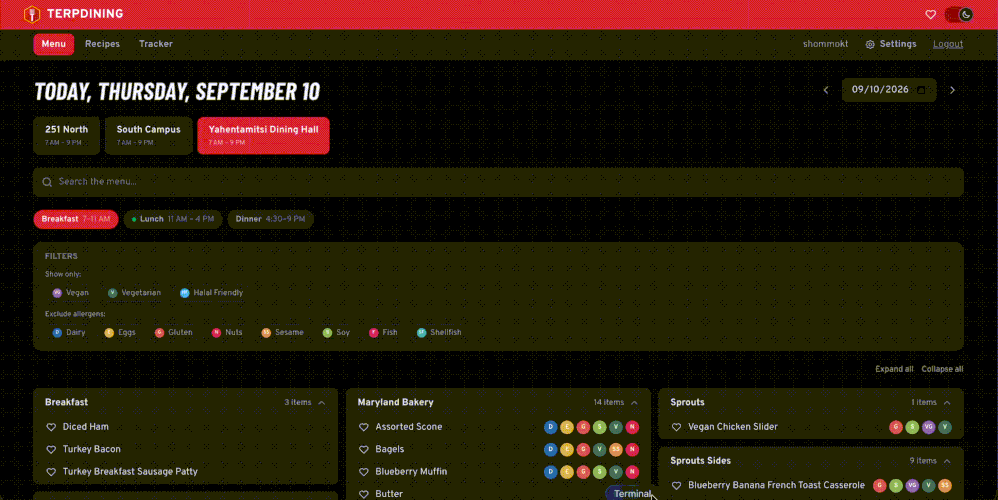
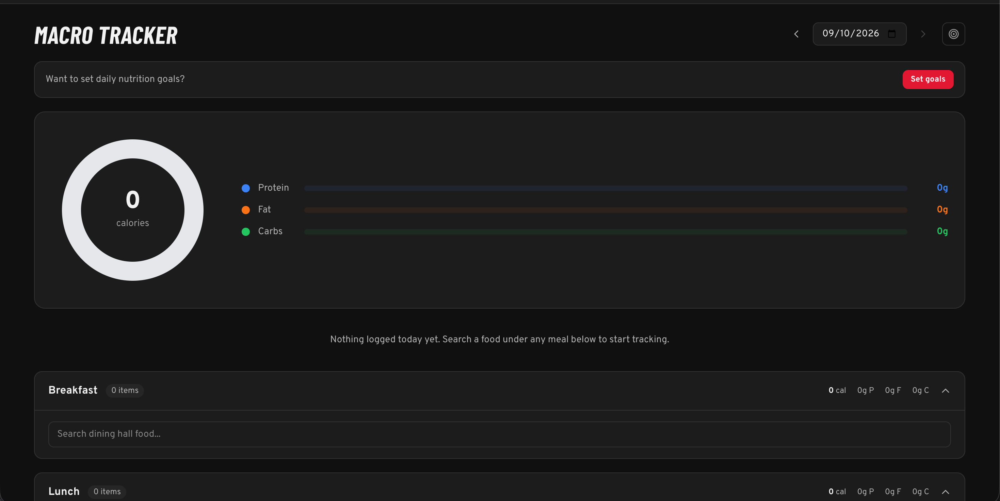
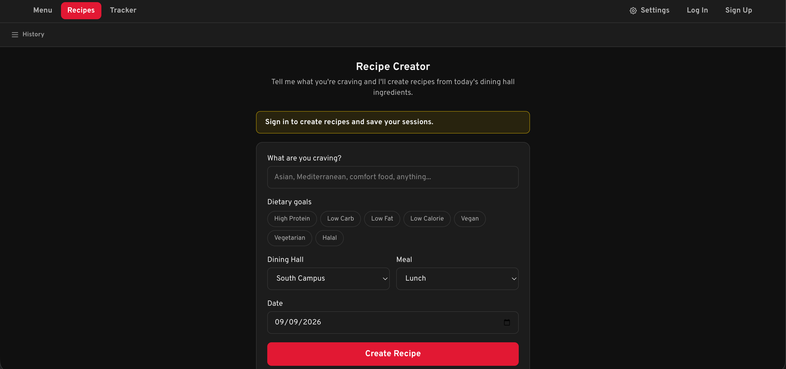

  

# TerpDining

UMD dining hall app. Check menus, track macros, and get creative recipes from food thats available on that day, on web and IOS. Unofficial
student project, not affiliated with or endorsed by the University of
Maryland.

**Live: [terpdining-web.onrender.com](https://terpdining-web.onrender.com/)**

## Screenshots

| Menu | Tracker | Recipe Creator |
|---|---|---|
|  |  |  |

## What it does

- **Menu**: every dining hall by meal and station, with dietary badges (vegan, halal, allergens) and a date picker.
- **Favorites**: heart an item to get notified when it's back on the menu.
- **Recipes**: AI suggests dishes assembled from what's actually available that day.
- **Tracker**: log food with realistic portions, see daily macros on a donut chart, goals synced across devices.

## Stack

| | |
|---|---|
| Backend  | FastAPI, SQLite, JWT auth, bcrypt |
| Frontend | React 19, Vite, Tailwind v4, React Router |
| Mobile   | Capacitor (iOS) |
| Recipes  | LangChain + Google Gemini |
| Scraping | BeautifulSoup, requests, APScheduler |
| Data     | nutrition.umd.edu |

## Recipe API setup

Create a Gemini API key in [Google AI Studio](https://aistudio.google.com/api-keys) under the Google Cloud project you want to use. Set `GEMINI_API_KEY` in the backend environment (and in Render's environment variables for production), then restart or redeploy the backend. The project ID or number is not an API key. Recipe generation defaults to `gemini-3.8-flash`; set `GEMINI_MODEL` to choose a different Gemini model. Keep the key out of the frontend and out of Git.

## Developer guides

- [Frontend packages and iOS build steps](frontend/README.md)
- [Backend packages and source layout](docs/dependencies.md)
