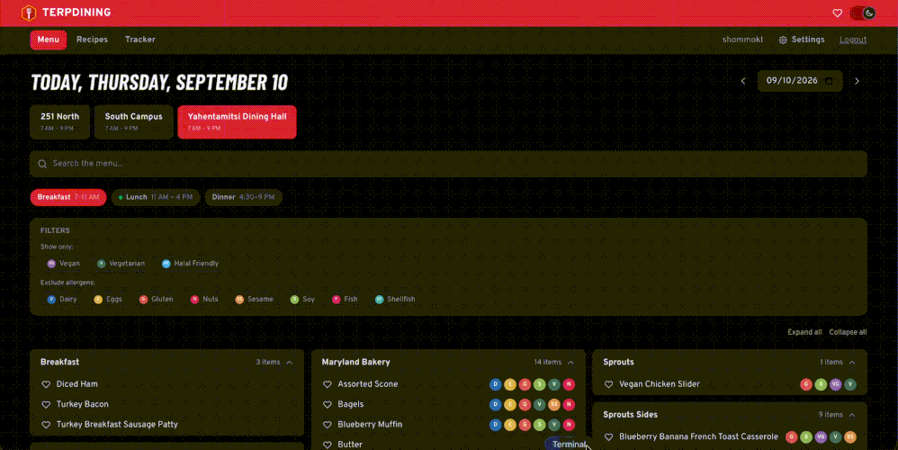
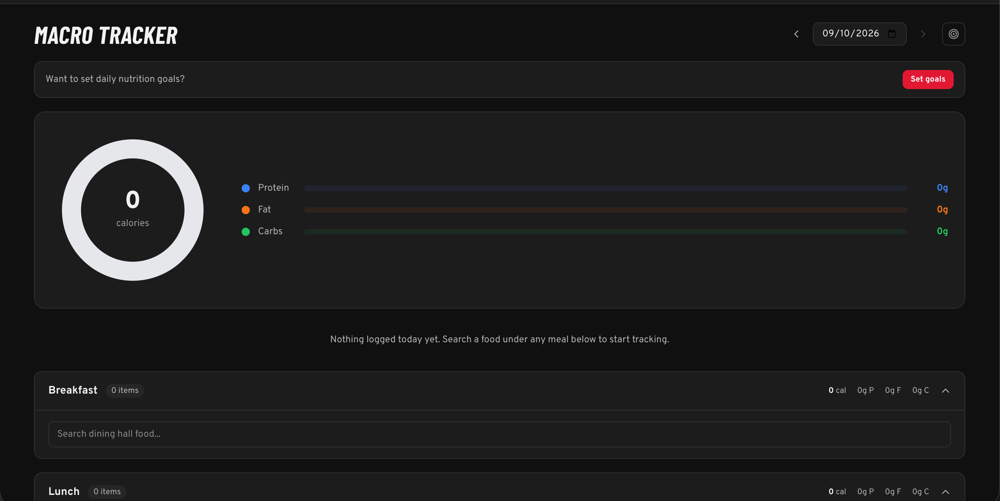
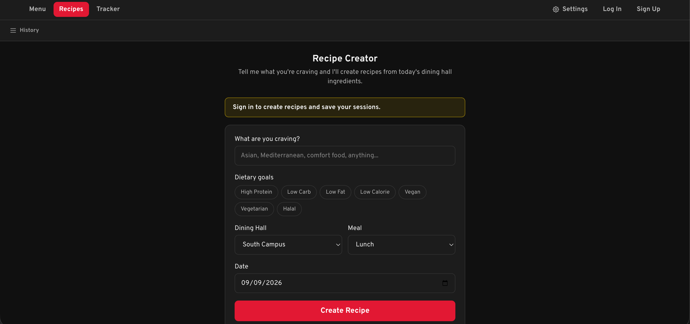

<p align="center">
  
</p>

# TerpDining

[](https://github.com/shommokt-ui/terpdining/actions/workflows/ci.yml)

UMD dining hall app. Check menus, track macros, and get creative recipes from food thats available on that day, on web and IOS. Unofficial
student project, not affiliated with or endorsed by the University of
Maryland.

**Live: [terpdining-web.onrender.com](https://terpdining-web.onrender.com/)**

## Screenshots

| Menu | Tracker | Recipe Creator |
|---|---|---|
|  |  |  |

## What it does

- **Menu**: every dining hall by meal and station, with dietary badges and a date picker.
- **Reviews**: rate and review dishes per dining hall.
- **Favorites**: heart an item to get notified when it's back on the menu.
- **Recipes**: AI suggests dishes built from what's actually on the menu that day.
- **Tracker**: log food with realistic portions, see daily macros, goals synced across devices.

## Stack

| | |
|---|---|
| Backend  | FastAPI, JWT auth, bcrypt |
| Database | PostgreSQL in production, SQLite locally |
| Frontend | React 19, Vite, Tailwind v4 |
| Mobile   | Capacitor (iOS, Android) |
| Recipes  | LangChain |
| Scraping | BeautifulSoup, requests, APScheduler |
| Data     | nutrition.umd.edu |

## Running locally

```bash
# backend
python -m venv .venv && source .venv/bin/activate
pip install -r requirements-dev.txt
cp .env.example .env
python run_scraper.py                  # load this week's menus
python -m uvicorn server:app --reload

# frontend
cd frontend && npm install && npm run dev
```

The backend uses PostgreSQL when `DATABASE_URL` is set (production) and a local SQLite file otherwise. Tests always use SQLite.

For recipes, add your AI API key and model name to `.env`.

## Docs

[Frontend and iOS](frontend/README.md) · [Backend layout](docs/dependencies.md) · [Deployment](docs/DEPLOYMENT.md) · [Load testing](scripts/LOAD_TESTING.md)
